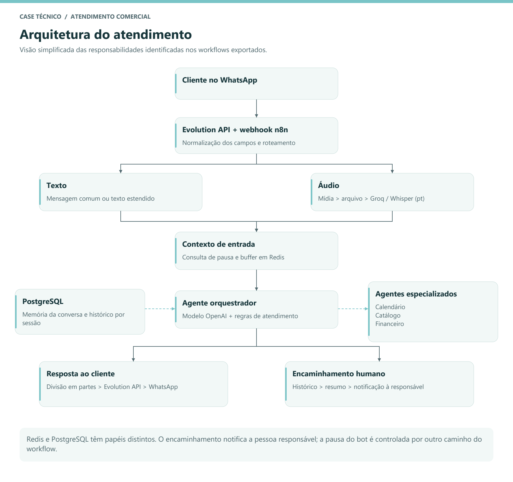
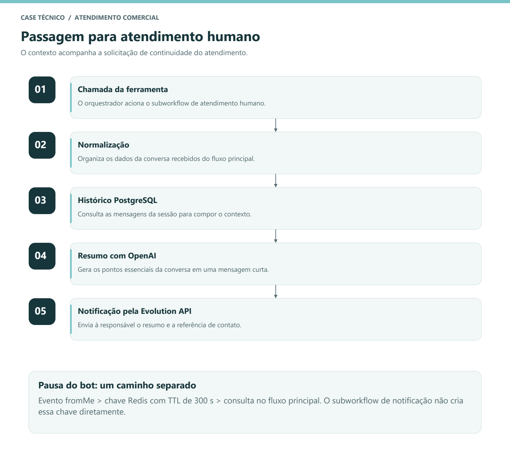

# Agente de IA para Atendimento Comercial via WhatsApp - NB Store

Case técnico de uma automação desenvolvida para a NB Store, com n8n,
Evolution API, modelos de linguagem, Redis e PostgreSQL.

**Desenvolvimento:** Carlos Vinícius dos Santos Domingos | Diagonal Tech  
**Formato:** documentação de arquitetura, diagramas e exemplos de interação.  
**Cliente:** NB Store, com divulgação de nome e logo autorizada, conforme informado pelo desenvolvedor.  
**Uso real:** cinco meses de uso pela cliente, com utilização de todas as funcionalidades, conforme relato do desenvolvedor.

## Problema

O atendimento comercial por WhatsApp reúne perguntas sobre produtos, mensagens
de voz, solicitações de visita e situações que exigem uma pessoa. A proposta do
projeto foi organizar essas entradas e automatizar parte das respostas, mantendo
regras de negócio e uma passagem de contexto para o atendimento humano.

## Solução desenvolvida

Construí workflows no n8n para receber eventos do WhatsApp pela Evolution API,
normalizar as mensagens e direcioná-las a um agente orquestrador. O fluxo integra
transcrição de áudio, histórico de conversa, buffer de mensagens e ferramentas
especializadas para agenda, catálogo e informações financeiras.

No encaminhamento humano, um subworkflow consulta o histórico, gera um resumo e
notifica a responsável pela loja. Essa passagem de contexto é uma parte importante
da arquitetura: a pessoa que assume o atendimento recebe os pontos da conversa.

## Uso real e resultados disponíveis

A cliente utilizou o agente por **cinco meses**, utilizando todas as
funcionalidades da solução, conforme confirmação do desenvolvedor. O projeto
teve, portanto, uso real no atendimento da NB Store, além da arquitetura
documentada neste repositório.

O período e o escopo de uso foram informados pelo desenvolvedor. Os exports
permitem examinar os componentes técnicos, mas não medem o tempo de operação.
Volume de mensagens, economia de tempo e impacto em vendas não foram fornecidos.

## Arquitetura

1. Um webhook recebe o evento da Evolution API.
2. Os campos são normalizados e o tipo da mensagem define o tratamento.
3. Texto segue para a mensagem comum; áudio passa por obtenção da mídia,
   conversão e transcrição em português via Groq/Whisper.
4. O caminho principal consulta o controle de pausa e reúne mensagens em Redis.
5. O orquestrador utiliza um modelo OpenAI e memória de conversa em PostgreSQL.
6. Ferramentas especializadas atendem solicitações de agenda, catálogo,
   informações financeiras e encaminhamento humano.
7. A resposta é dividida em partes e enviada pela Evolution API.

O diagrama é uma síntese da estrutura exportada, não um registro de execução.
A leitura detalhada está em [arquitetura.md](docs/arquitetura.md).

## Componentes identificados nos workflows

| Componente | Papel no projeto |
| --- | --- |
| n8n | Orquestração, roteamento, chamadas HTTP e subworkflow humano |
| Evolution API | Recebimento dos eventos e envio de mensagens pelo WhatsApp |
| OpenAI | Modelo do orquestrador, agentes especializados e resumidor |
| Groq + Whisper | Transcrição de mensagens de voz em português |
| PostgreSQL | Memória conversacional conectada ao orquestrador e ao histórico do resumo |
| Redis | Buffer temporário e chave de pausa após evento de mensagem própria |
| Google Calendar | Ferramentas de busca, criação, atualização e exclusão de eventos |

Esta lista descreve a configuração dos arquivos analisados. Não representa uma
nova validação operacional das integrações ou de suas credenciais.

## Funcionalidades da solução

O desenvolvedor confirmou a utilização de todas as funcionalidades pela cliente.
A lista abaixo destaca os recursos identificados no caminho principal e no
subworkflow de atendimento humano; não inclui nós auxiliares desconectados como
se fossem funcionalidades adicionais em uso.

- Roteamento de texto e áudio para um processamento comum.
- Transcrição de áudio antes da interpretação pelo agente.
- Contexto de conversa por sessão em PostgreSQL.
- Buffer temporário com Redis e verificação da última mensagem.
- Orquestrador com agentes de calendário, catálogo e financeiro.
- Subworkflow de encaminhamento com histórico, resumo e notificação.
- Caminho de pausa temporária do bot associado a eventos `fromMe`.
- Divisão da resposta em mensagens menores e envio pela Evolution API.

## Encaminhamento humano

O orquestrador pode chamar uma ferramenta de workflow quando o cliente pede uma
pessoa ou chega a uma situação prevista nas regras do negócio. O subworkflow:

1. recebe os dados necessários ao encaminhamento;
2. normaliza o contexto recebido;
3. consulta o histórico associado à sessão;
4. produz um resumo curto com um modelo de linguagem;
5. envia à responsável uma notificação com o resumo e o contato da conversa.

O envio dessa notificação e a pausa do bot são caminhos diferentes. No export,
a chave de pausa em Redis é criada por um evento `fromMe`, com TTL de 300
segundos. O subworkflow de notificação não cria essa chave diretamente.

## Redis e PostgreSQL: responsabilidades distintas

Redis é utilizado no caminho de buffer e de pausa temporária. PostgreSQL está
conectado como memória do agente e como fonte do histórico usado no resumo.
Essa distinção evita confundir armazenamento temporário de mensagens com o
contexto conversacional consultado pelos modelos.

## Regras do atendimento

Os prompts orientam respostas curtas, identificação do interesse do cliente e
consulta às ferramentas responsáveis por agenda e informações financeiras.
Pedidos para conversar com uma pessoa são tratados de forma diferente de
pedidos de agendamento de visita.

Há uma instrução para manter o atendimento automático entre 22h e 6h.
No material analisado, essa restrição aparece no prompt; não foi identificado
um bloqueio determinístico por horário no subworkflow humano.

## Exemplos de interação

Os exemplos abaixo são recriações de diálogo baseadas nas regras do projeto.
Não são logs de execução ou medições de produção.

| Atendimento por texto | Compreensão de áudio | Encaminhamento humano |
| --- | --- | --- |
|  |  |  |

As imagens foram recriadas para ilustrar o estilo de atendimento da agente.

**Texto**

> Cliente: Vocês trabalham com relógios femininos?  
> Assistente: Trabalhamos sim! Você procura algo para o dia a dia ou para presentear?

**Áudio**

> Conteúdo do áudio: Procuro um perfume suave para presentear minha mãe.  
> Assistente: Entendi! Ela prefere fragrâncias florais ou mais fresquinhas?

**Atendimento humano**

> Cliente: Quero finalizar a compra e falar com a Nayara.  
> Assistente: Tudo certo! Vou encaminhar seu atendimento para a Nayara, tudo bem?

O [carrossel em PDF](linkedin/carrossel-case.pdf) apresenta o problema, a estrutura
e as decisões técnicas em formato visual.

## Decisões técnicas e aprendizados

- Separar o canal de entrada do processamento permite tratar diferentes tipos
  de mensagem antes de encaminhá-los ao agente.
- Agentes especializados ajudam a organizar responsabilidades de agenda,
  catálogo e financeiro.
- O histórico melhora a continuidade do atendimento e permite resumir o contexto
  para a pessoa que assume a conversa.
- Uma instrução no prompt e uma validação determinística oferecem garantias
  diferentes; regras críticas precisam ser verificadas fora do modelo.
- Um export mostra estrutura e configuração, mas a confirmação do comportamento
  depende de execução controlada, credenciais e observação dos resultados.

## Escopo da revisão e limitações

Este case foi documentado a partir de dois workflows exportados, dos prompts
locais e do relato do desenvolvedor sobre cinco meses de uso pela cliente.
Nesta revisão documental, os serviços não foram executados novamente.
Não são apresentados volume de atendimentos, economia de tempo, taxa de
conversão ou disponibilidade, pois essas métricas não foram fornecidas.

O export contém trechos auxiliares desconectados, condições que precisam de
revisão e parâmetros cuja configuração deve ser confirmada antes de uma nova
ativação. A duração do buffer não é afirmada: o nó de espera tem quantidade 12,
mas não registra explicitamente a unidade no arquivo.

Existe também um ramo de ferramentas MCP de calendário separado do caminho
principal. O case descreve a integração de calendário diretamente conectada ao
agente, sem atribuir a esse ramo MCP uma execução comprovada.

## Próximas melhorias

- Consolidar os prompts do export e dos arquivos de documentação.
- Revisar condições de buffer, unidade de espera e consistência do histórico.
- Validar mensagens de diferentes tipos em um número de teste.
- Aplicar regras de horário em validações determinísticas.
- Registrar erros, tempo de resposta e eventos de encaminhamento.
- Medir resultados com autorização e dados de operação disponíveis.

## Sobre este repositório

Este é um repositório de documentação do case. Os workflows originais, prompts
com dados da cliente, endereços de servidores e referências de credenciais não
fazem parte do material público. Não é um pacote para importar diretamente em
uma instância n8n.
